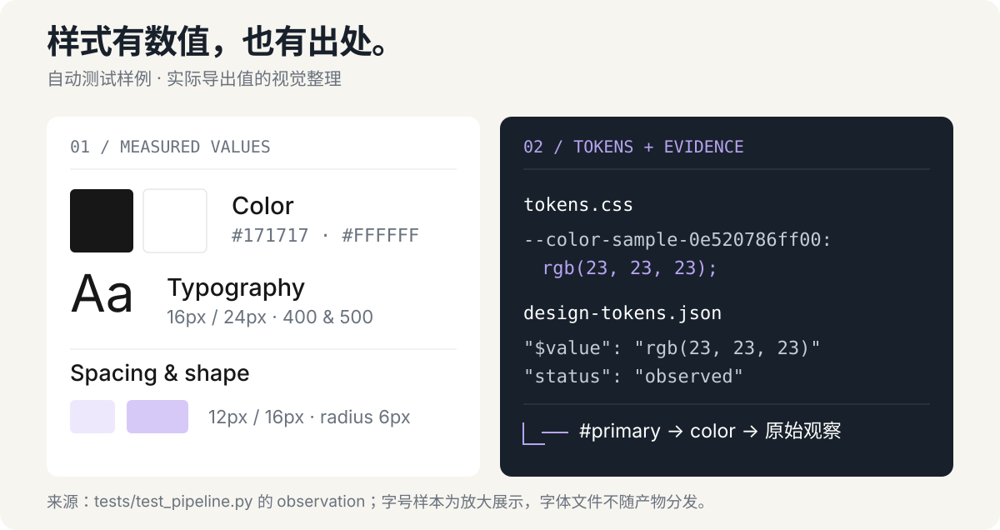
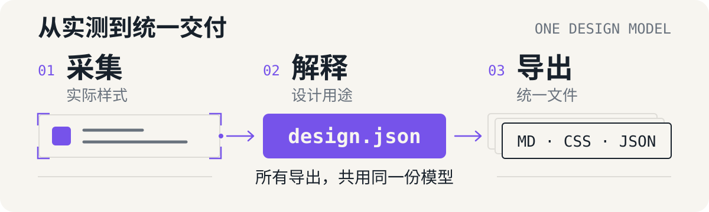

# yoho-design-extractor

把网站的视觉语言，整理成有来源依据的设计文件和本地预览。



上图是自动测试样例的 SVG 示意，数值来自实际导出器：文字色 `#171717`、字号/行高 `16px / 24px`、间距 `12px / 16px`、圆角 `6px`。每个值保留来源引用；此样例用于说明输出结构。

[开始使用](#开始使用) · [交付文件](#交付文件) · [采集方式](#采集方式) · [适用边界](#适用边界)

## 开始使用

让 Agent 安装，复制这句话：

```text
请帮我安装这个 Skill：https://github.com/Yohoia/yoho-design-extractor
```

也可使用 Skills CLI：

```bash
npx skills add Yohoia/yoho-design-extractor --skill yoho-design-extractor
```

安装后，向 Agent 提出第一个请求：

```text
提取这个网站的设计规范，生成 DESIGN.md 和可预览的样式文件：<网址>。只分析这一个页面。
```

CLI 安装需要 Node.js。手动安装时，把仓库根目录复制为 Agent 的 `yoho-design-extractor` Skill 文件夹；支持本地路径的环境也可直接引用 [SKILL.md](SKILL.md)。无需预装 Firecrawl Skill。

## 交付文件

输出保存在 Skill 外部的新目录，整个目录可搬移。

| 文件 | 用途 |
| --- | --- |
| `DESIGN.md` / `DESIGN.compact.md` | 完整与精简设计参考 |
| `tokens.css` / `tokens.compact.css` | CSS Variables：完整分类 / 颜色与字体 |
| `tailwind.css` / `tailwind.compact.css` | Tailwind v4：完整主题 / 颜色与字体 |
| `design-tokens.json` / `design-tokens.compact.json` | 面向 CSS 的 Design Tokens：完整 / 精简分类 |
| `preview.html` | 双栏样式参考，切换格式、复制与下载 |
| `design.json` / `evidence/` | 可编辑数据、原始观察、截图与覆盖记录 |

预览内嵌数据，无需远程脚本、CDN 或 Tailwind；可在允许打开本地文件的浏览器中使用。验证结果记录于 `verification.json`，导出清单记录于 `export-manifest.json`。

预览左侧依次为标题与简介、Color Palette、Typography、Spacing & Shape、Guidelines；四种格式都可切换 Compact/Extended。文档按字体、字号和间距用途分组，组件使用自然语言说明；Extended 到 Elevation、Compact 到 Surfaces 结束。证据与未确认项保留在独立数据文件中。

## 采集方式



DOM 计算样式与源 CSS 声明保留测量依据，Agent 解释名称、用途与设计建议；全部导出共用一份 `design.json`。

核心需要 **Python 3.10+**，只使用标准库。采集需要至少一条可用路线：能读取 DOM 与计算样式的宿主浏览器、Firecrawl 连接器、已有 CLI，或 HTTP API。API 路线无需安装 Firecrawl CLI/SDK。

修改 `design.json` 后重新导出。再次 `build` 生成候选，保留已有人工解释；采集失败保留成功快照，可恢复后继续。操作细节见 [主流程](SKILL.md) 与 [交付规范](references/delivery.md)。

单色导出统一使用 hex，透明色保留 alpha；Oklab 等单色转换为 sRGB hex。渐变在预览与文档表格中显示 `Gradient`，CSS 和 JSON 中保留可执行定义与 hex 色标。原始颜色表达留在证据中；宽色域转换的裁剪会另行标记。

<details>
<summary>可选：配置 Firecrawl API 凭据</summary>

优先复用运行时 `FIRECRAWL_API_KEY` 或宿主安全入口。缺少安全入口时，可使用本地凭据页；要求 Node.js 22.18+ 与系统凭据服务。

在 Skill 根目录执行：

```bash
cd scripts/credential-ui
npm ci --ignore-scripts
node src/profile.ts setup firecrawl
```

用户亲自打开返回的本机链接并保存 Key；密钥存入系统凭据库，不需贴进聊天。存储引用兼容此前保存的 Key，Skill 改名不会迁移或删除凭据。

凭据页和 Node.js 是可选配置，宿主浏览器路线不需要它们。更多说明见 [凭据组件](scripts/credential-ui/README.md) 与 [Firecrawl 适配](references/firecrawl.md)。

</details>

## 适用边界

- **页数**：`single` 仅输入页；默认 `standard` 通常选 3 个代表页、最多 5 页；`extended` 使用用户指定上限。没有新增设计信息可提前停止。
- **状态**：每页默认观察桌面与移动。Firecrawl 批采集器只自动采 `default`；hover、focus、展开状态需由浏览器或连接器补采。
- **证据**：未捕获截图、字体未加载、采样截断、Canvas/WebGL 无法逐元素测量等缺口会单独记录。实测、推断、补全与未知项分别标注。
- **适用范围**：默认同源公开页面，登录或跨源需明确指定；不承诺全站完整，也不恢复私有源码或未观察到的官方规范。
- **数据与收费**：本地浏览器证据留在本地；云端路线把目标 URL 与采集代码发给 Firecrawl，不上传本地文件或浏览器登录态。服务按其额度与规则收费，不自动购买额度。
- **兼容性**：开发平台为 macOS；Windows/Linux 未做端到端实机验证。字体栈不等于字体文件，特定设计工具的 JSON 导入未验证，Tailwind 文件需已有构建环境。

程序验证检查实测引用和导出一致性；浏览器交互、人工视觉确认与自动触发准确率需分别验证。输出默认留在本地，不自动发布。

## 开发与来源

在仓库根目录运行：

```bash
python3 -m unittest discover -s tests -v
```

凭据组件的检查、构建、测试与原生测试见其 [README](scripts/credential-ui/README.md)；原生测试使用随机假凭据并清理。

采用 [MIT 许可](LICENSE)。方法参考 [website-rebuild](https://github.com/boyang-hu/website-rebuild-skill) 的证据留存与 [Refero](https://styles.refero.design/) 的展示结构；可选凭据组件来自 oil-skill-creator，保留源码、测试与 [MIT 许可](scripts/credential-ui/LICENSE)。Firecrawl 与 Tailwind 的服务和构建能力由各自项目提供。
